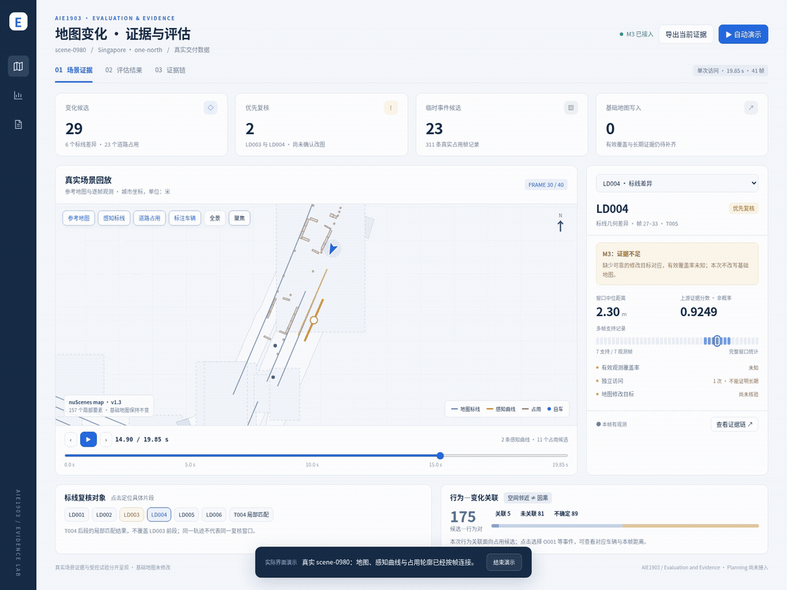

# Evaluation and Evidence · 实际运行 Demo

本目录包含从真实 scene-0980 和成员交付构建的仪表板，以及实际浏览器界面演示。没有把旧 synthetic demo 的虚构复访接入本页面。

- 动图直接展示约 32 秒交互流程；MP4 是清晰版。
- `AIE1903_interactive_demo.zip` 解压后双击 `index.html`，无需安装 Python 或前端依赖。
- 三个页面分别为场景证据、评估结果、证据链。
- 真实基础地图仍未修改；受控评估与真实准确性分别展示。

本分支还包含可复现源代码。63 项代码测试、24 项浏览器检查通过。
