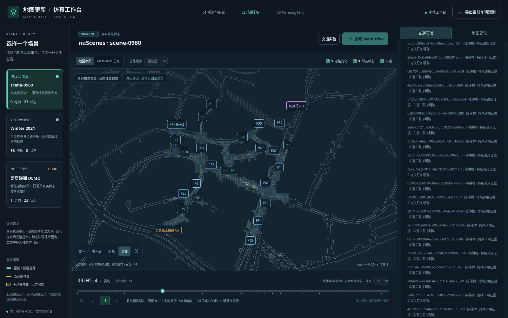
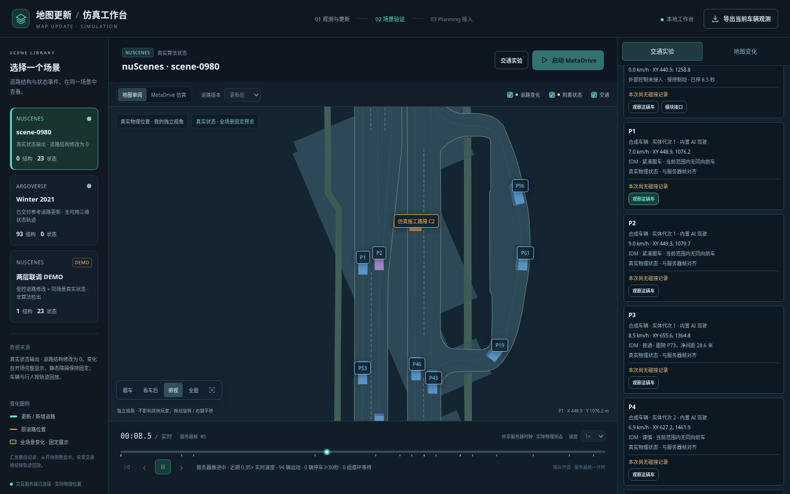

# 工作台实际运行预览

源码版本 `2fc7c47`，在 Codex 环境通过 Chromium 访问本地工作台，启动原生 MetaDrive/Bullet 后实录。不是宽恒云部署，不是生成图片或真实传感器数据。

配置：开放路网、96 辆背景车、16 名仿真行人、混合事件、seed 0；另有等待外部控制的 ego/P0。

[21 秒运行视频](workbench-demo.mp4) · [全图](workbench-overview.png) · [车辆视角](workbench-traffic.png) · [采样记录](capture.json)

采样从仿真 5.4 秒到 11.2 秒，运动车辆 94→89，已完成行程 3→10，浏览器没有脚本异常。该机器当时约 0.30 倍实时速度，不是宽恒云性能测试。视频在 Chromium 实际播放验证，时长 21.52 秒。

短时预览不能证明持续交通完成。已有 300 秒测试仍有接近 290 秒的长期等待，阶段二尚未完成，详见 [停滞诊断](../../../docs/traffic_stall_diagnostics.md)。
