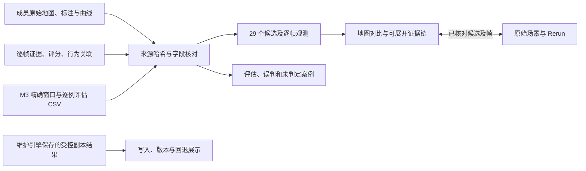

# 地图决策、证据链与评估工作台（2026-11-08）

当前版本完成自动处理后直接保存事件与观测结果，不再要求人工复核。29 个候选对应 23 个占用事件、6 个标线差异；基础图结构写入仍为 0。原诊断、真实准确率和受控实验指标保持原义。详见 [自动处理方法与输出](automatic_processing.md)。

英文入口：https://yugongshit.github.io/AIE1903-map-update66/en/index.html#decisions

中文入口：https://yugongshit.github.io/AIE1903-map-update66/zh/index.html#decisions

这次增加三个可以操作的部分：地图与观测/处理结果对比、单个候选的证据链、可以展开具体案例的评估。原始场景、成员视频、原类别标注和内嵌 Rerun 继续保留。

## 建议演示顺序

1. 默认打开 **LD003，第 18 帧**。拖动地图中间的分界线，比较参考地图与该帧观测；也可以叠加、平移和缩放。下方 41 帧时间轴区分支持、不支持与没有记录的帧。
2. 点击“对比处理结果”，查看已经保存的标线差异或占用几何，以及基础图动作。LD003 的规则分数为 1.00，但分数不是正确概率，也不能代替可靠性、修改目标和独立复访证据。
3. 点击下面的感知、多帧验证、可靠性与地图决策卡片，展开原始字段、候选 ID、时间窗口、来源路径和 SHA256。M3 的 T004 第 26–40 帧诊断与 LD003 第 18–25 帧严格分开。
4. 选择一个占用候选，例如 O001。点击图上的物体，查看成员数据里的原始类别、实例 token 和尺寸。无记录的帧不继续显示旧物体，也不被解释为障碍已经清除。占用留在事件候选层，不被自动改成车道封闭或已确认短期事件。
5. 切换到“受控写入实验”，选择 0.6 / 0.8 / 1.2 米偏移。依次点击原始、0 小时、12 小时、26 小时、回退。26 小时阶段显示维护引擎已经保存的副本几何修改与版本；回退恢复原坐标并追加版本。局部放大图便于看清实际偏移。
6. 打开“评估检查”。真实场景显示标注缺口和已处理案例；受控评估可以切换方法、覆盖率条件，并查看误报、漏报及源实验的未判定类别。历史类别不创建新的人工任务。CSV 和单例证据 JSON 可以下载。
7. 点“原始场景”或“Rerun”，继续看同一候选/帧。已核对场景的 Rerun 时间轴和候选可以同步回工作台；未知本地录制仍使用独立时间轴。

## 教授询问时可以这样解释

> 我们把成员交付的检测、逐帧验证、可靠性和行为关联结果接到同一个候选上，显示观测在哪里、证据来自哪里、哪些条件满足、哪些条件仍然缺失。地图决策保留这些依据。真实场景暂时没有足够依据写入基础地图；受控实验独立展示引擎的几何修改、版本记录和回退。评估同时报告有判定样本上的 F1、判定覆盖率和全部正例上的召回率，并允许检查错误和未判定的案例。



展示层不重新预测物体、不改变标注或重新制造评估分数。英文保留原类别，中文只翻译显示名称。成员的多帧验证与可靠性是汇入地图决策的两项依据，不伪造它们之间的串行依赖。

## 数据和解释边界

| 项目 | 本次可以确认的范围 |
| --- | --- |
| 真实数据 | 仅 nuScenes scene-0980，41 帧，约 19.85 秒，一次访问；29 个候选（23 个占用、6 个标线差异）。Argoverse 尚未运行。 |
| 真实改图 | 基础地图写入为 0；长期/短期不能靠单次短片段确认；占用清除没有被证实。 |
| 来源 | 157 个源地图元素、2,278 条原物体标注，以及交付的 332 行逐帧证据、13 个行为片段、175 对关联。行为关联只表示时空接近，不证明因果。 |
| M3 对齐 | 六个未匹配的标线候选与一个独立匹配窗口，共七个复核单元。不能把同一 track 后续窗口的诊断传播到先前候选。 |
| 距离 | 地图上的单点最近参考距离是浏览辅助量。LD003 第 18 帧约 2.87 米与源窗口距离中位数约 7.07 米采用不同定义；前者不是已验证修改目标，也不是几何准确率。 |
| 真实准确率 | 217 条独立标签均缺失，Precision、Recall、F1 保持未知，不能从规则分数推算。 |
| 受控 M3 评估 | 126 个案例源自同一场景三个窗口的依赖性扰动，不是 126 个独立实景。质量门控方法的已判定 F1 为 94.1%，判定覆盖率仅 28.6%，全部正例召回率为 22.2%，须一起展示。 |
| 受控写图 | 与 M3 扰动评估分开。偏移、0/12/26 小时复访、95% 覆盖率和对齐条件为人为输入；写入和回退结果来自现有引擎在隔离地图副本上的实际输出。没有匹配的真实候选，没有修改真实地图。 |
| 相机与规划 | 原始视频可播放；现有文件没有车前 JPG。标定投影不等于实景照片，实际轨迹不等于推荐路线。规划及跨车共享未接入。 |

## 代码职责

- `map_update/decision_data.py`：核对源 CSV 哈希、候选字段、逐帧证据与关联，重新计算受控指标并要求与已核对结果完全相同；生成只用于展示的类别索引和单点距离。
- `map_update/decision_studio.html`、`.css`、`.js`：两个新工作区、双语交互、地图对比、证据展开、案例导出和评估筛选。原有四组核心数据在交互过程中保持不变。
- `map_update/rerun_bridge.js`：保留官方查看器，增加向新工作区同步已核对候选的逻辑。
- `scripts/build_decision_studio.py`：在已检查通过的 Rerun 网站上构建新版；保留来源报告，原样复制视频、RRD 和查看器。
- `scripts/check_decision_studio.py`：浏览器交互、数据不变性、窗口对齐、受控回退和案例统计检查。

## 构建与验证

需要此前已通过检查的 Rerun 网站、仓库中完整的 `external/perception_delivery`、M3 补充材料以及 Python、Playwright 和 Chromium。构建输出目录必须不存在。原 Rerun 构建步骤见 [接入说明](rerun-integration.md)。

```bash
python scripts/build_decision_studio.py \
  --source outputs/nuscenes/scene-0980/rerun-release-20261105 \
  --out outputs/nuscenes/scene-0980/decision-release-new \
  --cases 'AIE1903 原始资料/M3_scene0980_proposal_supplement 2/results/controlled_case_decisions.csv' \
  --comparison 'AIE1903 原始资料/M3_scene0980_proposal_supplement 2/results/controlled_comparison.csv'
python -m unittest discover -s tests -q
python scripts/check_decision_studio.py outputs/nuscenes/scene-0980/decision-release-new
python scripts/check_bilingual_studio.py outputs/nuscenes/scene-0980/decision-release-new
python scripts/check_rerun_site.py outputs/nuscenes/scene-0980/decision-release-new
```

本次结果：核心 114 项、决策工作台 65 项、原双语功能 40 项、Rerun 35 项，全部通过。检查覆盖全部 29 个候选的自动结果与五个证据面板、20 个高证据候选筛选、几何导出、双语切换、手机宽度、地图拖动、实际几何回退、CSV 统计和 Rerun 双向同步；正常流程无 JavaScript 异常或资源请求失败。机器可读结果见 [验证记录](decision-validation-20261108.json)。

浏览器范围是云端 Chromium / SwiftShader；没有声称验证实体 Mac、Safari 或车辆。静态页面部署由 GitHub Pages 工作流的准确提交状态另行确认，不把上一版本的部署记录当成本次结果。
