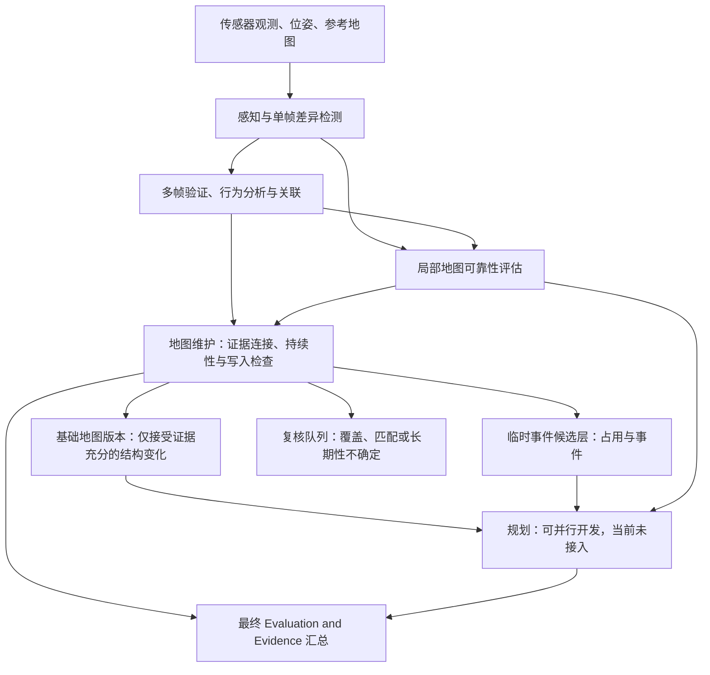

# 可靠性接入、地图维护架构与答辩说明

> 更新说明（2026-11-04）：本文件保留此前的核查记录。M3 已接入，最新展示和本轮问题以 [场景与地图维护工作室](visual_studio.md) 及网站“问题清单”为准；旧的“可靠性未收到”等表述不再代表当前状态。

核查日期：2026-11-03。GitHub 数据提交：ba59989。场景：nuScenes scene-0980 / singapore-onenorth。

## 1. 先回答现在能不能改地图

**不用等 Planning 才能开发地图更新。** 规划解决“车辆接下来怎么走”，地图维护解决“哪些证据足以改变地图中的要素”。两者可以消费同一批感知、可靠性和事件数据，地图维护不依赖规划器先给出一条路线。

**现在已经能运行地图维护流程，但这次真实数据还不足以批准长期基础地图修改。** 已接入梅子衡的真实 M3 结果，将标线差异放入复核队列，将道路占用及其真实轮廓放入临时事件候选层。基础地图修改数为 0。已有更新引擎可以在输入条件满足时执行标线修改、生成版本并回退；这些操作逻辑通过了受控输入测试，不能说 scene-0980 已经验证了一次真实长期地图更新。

临时事件层是一份与基础地图分开保存的事件数据，例如某帧某辆车占用了某条车道多少空间。放入这个层，表示暂不写成稳定地图要素；**不等于已经证明障碍只存在很短时间，也不等于车道应当封闭。** 未确定长期或短期时，我们保留“证据不足”状态，不强行二选一。

## 2. 本次接收到了什么

新资料位于 `AIE1903 原始资料/M3_scene0980_proposal_supplement 2/`，共 23 个文件，包含分析脚本、真实场景结果、覆盖率补录模板、受控扰动试验和说明。这不是只有文字的 proposal。

| 内容 | 本次实际结果 | 可以得出的结论 |
| --- | --- | --- |
| 原始场景 | 41 帧，约 19.85 秒，1 次访问 | 有一次经过的连续观测，不能当作跨日复访 |
| 标线差异候选 | 6 个 | 值得核查的地图—观测差异，尚不是已确认的改图操作 |
| M3 已匹配局部窗口 | T004，第 26–40 帧，共 15 帧 | 相对同场景 T001 参考，15 帧均未超过经验异常阈值 |
| M3 总复核对象 | 1 个局部窗口 + 6 个标线候选 = 7 个 | 全部为 Insufficient Evidence，未决；不等于 7 个真实变化 |
| 有效观测覆盖率 | 未知 | 不能把“没检测到异常”当作地图正确或道路恢复 |
| 明确决策覆盖率 | 0 / 7 | 有多少复核对象能给出明确正/负结论；与物理可见覆盖率不同 |
| 优先复核 | LD003、LD004 | 优先排查，不代表已经确认改图 |
| 占用候选 | 23 个，311 条占用帧记录 | 保存真实物体轮廓和关联车道，交给通行复核 |
| 基础地图 | 157 个局部要素，保留源几何 | 原图保持不变，长期更新数为 0 |

一个关键例子：LD003 属于 T004 的第 18–25 帧，而 M3 的局部匹配窗口属于第 26–40 帧。**同一轨迹编号不能代替相同的时间、位置和分析对象。** 后段“在参考范围内”不会自动取消前段的差异候选。

## 3. 我们的架构



图中箭头表示数据依赖。Planning 可以读取地图及事件信息，不是基础地图更新的必经前置步骤。最终汇总位于末端，检查各模块给出的证据能支持什么结论。向其他车辆分发地图仍属于 Extension，本次没有实现车队共享。

## 4. 每一步具体怎么实现

### 4.1 输入连接与身份核验

`scene.py` 读取原始地图、帧表、真实有序标线、nuScenes 标注车辆轮廓，以及已经交付的多帧/行为结果。保留城市平面坐标（米）、地图版本、文件 SHA-256、地图要素 token、候选编号、轨迹编号和绝对时间。微秒时间戳精确乘 1000 后保存为十进制纳秒字符串，避免浏览器大整数精度损失。

新增 `reliability.py` 将 M3 结果接入这些实际数据，核验同一场景、同一地图文件与版本、同一候选、同一帧范围及时间。局部匹配记录还要核对观测曲线及地图线 token。重复记录、重叠窗口重复引用、错误时间、错误地图、受控实验记录混入真实场景，都会被拒绝。

六个 LD 候选连接各自的 M3 记录；T004 局部匹配作为独立复核对象保留。23 个 OCC 不属于此次标线 M3 的分析范围，不给它们套用标线可靠性结论。

### 4.2 梅子衡的可靠性方法

对已经有局部地图线对应的观测，先将感知点投影到有限地图线段，筛除端点/歧义对应、方向不合适等点，再分析带符号的横向偏差。T001 的 21 条观测作为本场景参考；使用参考中位数及 1.4826 × MAD 标准化，取参考异常分数的经验 95% 分位数作为筛查阈值。

这个分数回答“相对当前参考，偏差有多异常”，并不直接回答“地图改变的概率是多少”。参考和目标来自同一次经过，不能称为独立标定。补充的经验尾部排名也不是已校准的 p 值。

最终决策首先检查有效覆盖率。当前覆盖率未知，七个对象都保留证据不足。几何可用点比例 2407 / 3070 只描述已检出点中多少通过几何筛选，**不能代替目标道路/标线真实可见、有效观测的比例**。坐标变换往返误差很小，也不能代替实际物理投影对齐核验。

### 4.3 基础地图、事件层和复核队列

本次新增命令 `integrate-m3` 输出：

| 文件 | 含义 |
| --- | --- |
| `reference_map.json` | 原参考地图及版本、哈希、几何；不冒充已更新地图 |
| `event_layer.json` | 23 个占用事件候选、关联车道、逐帧物体轮廓、时间和占用量 |
| `reliability.json` | 七个 M3 复核对象、原始判断、优先级、未满足的条件和连接检查 |
| `maintenance.json` | 本次维护决策：基础地图更新 0，长期变化确认 0，未决 7 |
| `scene.json` / `replay.json` | 完整场景证据及逐帧几何，便于复查 |
| `validation.json` / `summary.json` | 数据连接核验及统计 |
| `index.html` | 原始地图、逐帧观测、占用轮廓、M3 原因和复核清单 |

输出是这段历史数据的记录，不表示这些障碍现在仍在道路上。没有观测的帧也不会自动产生“障碍已消失”的结论。本次不会生成假装能直接交给在线规划器执行的封路指令。

### 4.4 长期更新与版本回退

已有 `engine.py` 接收规范化且证据完整的输入。先检查可靠性决策、有效覆盖率、对齐状态、有效帧数和支持比例；再把连续帧按独立访问归并，检查时间跨度与跨访问几何稳定性；最后确认具体修改对象和操作。

目前可执行的写入范围是标线折线的新增、几何修改、标线属性修改和停用。不能由“标线差异”直接推导出删除一条车道或修改路网连通性。几何修改要覆盖原要素的足够范围，不能用局部短线覆盖整条边界。

每次实际写入保存修改前后对象、支持记录编号、父版本和新版本。回退会追加一个恢复版本，历史记录仍保留。引擎目前从指定基线完整运行一次输入，尚不是持续运行的生产数据库或多车辆并发系统。

默认规则为至少 3 次访问、计数访问间隔至少 1 小时、总跨度至少 24 小时，覆盖率至少 0.7、有效帧至少 3、支持比例至少 0.7、跨访问几何距离不超过 0.35 米。**这是可配置、尚未校准的原型初值，不是普遍成立的长期变化标准。** 不能把同一段视频复制或拆分成多个访问来满足门槛。

新 M3 接口当前严格对应本次“覆盖率未知”的交付。后续补齐真实覆盖数据后，需要按记录/帧/版本连接来源并重新计算可靠性，再扩展接口；仅把 JSON 里的 null 改成 1 不会获得写入资格。真实地图尚未核验历史基线语义，因此这次也没有将它强行包装成写入引擎的 verified_prior。

## 5. 现在还需要谁补交什么

| 成员/协作方 | 已有内容 | 接下来最小交付 |
| --- | --- | --- |
| 崔映庭：感知与单帧变化 | 场景、投影标线、候选、参考地图；车辆轮廓使用 nuScenes 标注 | 对 LD003/LD004 优先确认是误检、投影问题、地图表达差异还是真变化；给出目标要素、修改类型与可用观测几何。配合提供覆盖/遮挡核验所需影像、标定、位姿或有来源的测量结果 |
| 王子墨：多帧与行为 | 多帧候选、支持记录、行为片段及关联 | 保持事件—帧—轨迹连接；若要证明长期变化，协同获取同一地点独立时段观测、真实 visit_id、时间和目标对应。行为关联只作辅助证据，不能替代改图证明 |
| 梅子衡：可靠性 | 可复现代码、真实 handoff、统计诊断、覆盖模板、受控实验 | 补充有来源的目标长度、视野内长度、遮挡长度、有效观测长度及对齐核验；重新输出有效覆盖与可靠性决策。独立校准场景和标签用于后续准确性评价 |
| 潘明阳：Planning | 本次集成未接入可执行规划器 | 提交运行入口、依赖、地图/障碍/可靠性输入示例、起终点及输出轨迹，说明未知可靠性如何处理；做地图/事件变化前后的规划对比。它是完整项目的后续模块，但不是当前维护代码的阻塞项 |
| 黄子明：地图维护及最终 Evaluation and Evidence | M3 接入、真实事件层、复核队列；已有版本化更新与回退引擎 | 汇总地图基线语义、真实变更标签与复访证据；完成真实写入验证和误更新率/几何误差评价，最后汇总各模块证据 |

优先补齐四类输入：①有效覆盖与对齐证据；②同一地点独立时段观测；③明确的地图修改对象、操作和几何；④原参考地图与观测的时间关系。若客观上拿不到复访，就把真实结论限定为“单次访问差异检测和维护候选”，另外用明确标注的受控试验验证写入机制，不能将受控数据当作真实复访。

没有真值标签不阻止开发接口和运行原型，但会阻止诚实地报告真实 precision / recall / F1、误更新率或规划效果提升。Planning 完成后，可以增添完整项目的路线效果评价；现阶段不能声称已改善路径规划。

## 6. 教授问起来可以怎样回答

**问：你们到底改地图，还是只做可视化？**

答：我们实现了候选证据进入地图维护的流程，以及满足条件后的标线写入、版本追踪和回退。可视化用于审查输入和决定。本次真实场景因证据不足，进入事件层和复核队列，未修改基础地图；真实长期修改效果还没有得到验证。

**问：为什么不等 Planning 做完？**

答：地图维护依据观测、可靠性和持续性决定是否更新；规划依据地图及当前环境选择轨迹。规划不是写图的前置证明，但规划效果是完整项目可以进一步评价的结果。

**问：一个障碍出现在路上，为什么不直接把路删掉？**

答：占用不一定改变道路结构。我们记录它在哪条车道、哪一帧、占多大空间；是否还能通行要另做几何、车辆尺寸和安全约束检查，不能仅凭存在障碍就删除道路。

**问：M3 已经有结果，为什么还不能改？**

答：M3 已提供分析过程和结论，但七个真实对象都明确是证据不足。有效覆盖率未知，六个标线差异没有可靠的修改目标对应，还缺复访与地图时间语义。接收结果不等于所有条件已通过。

**问：score=1 是百分之百真实变化吗？**

答：不是。上游 score 是预设的多帧证据排序分数；M3 的异常统计又是另一个量。它们都不能直接解释为变化概率或长期性证明。

**问：15 帧没有异常，是不是地图正确？**

答：只能说 T004 第 26–40 帧已匹配局部段没有超过本场景参考阈值。覆盖率未知，因此不能推出整个区域正确，也不能消除第 18–25 帧的 LD003 候选。

**问：什么叫长期变化？**

答：在我们定义的观察周期内，经独立时段重复观测、可靠性与几何一致性检查支持的结构变化。原型通过可配置规则判定写入资格；它不证明变化永远不再改变。

**问：为什么现在用离线数据？**

答：项目目标是地图维护；离线表示本轮验证用已记录的数据，可以逐项复查。当前上游部分分数使用整个时间窗口，所以本轮不能直接声称具备在线规划和实时更新能力。

**问：你们测试结果说明了什么？**

答：56 项测试通过，说明已覆盖的输入检查、分层保存、持续性规则、更新和回退逻辑按预期执行。M3 的 13 个 CSV/JSON 文件复现后与交付字节一致，说明结果可重复。二者都不能替代独立真实测试集上的准确性评价。

## 7. 复现与检查

在仓库根目录运行。核心接入/维护代码使用 Python 3.10+ 标准库；复跑成员 M3 脚本需要 NumPy 和 Matplotlib。

```bash
python3 -m map_update integrate-m3 \
  --raw-root 'AIE1903 原始资料' \
  --handoff 'AIE1903 原始资料/M3_scene0980_proposal_supplement 2/results/real_scene_handoff.json' \
  --out outputs/m3-integrated-new

python3 scripts/verify_m3.py \
  --raw-root 'AIE1903 原始资料' \
  --m3-root 'AIE1903 原始资料/M3_scene0980_proposal_supplement 2' \
  --out outputs/m3-reproduced-new

python3 -m unittest discover -s tests -v
```

重复运行要换一个新的输出目录，程序不会覆盖已有结果。默认感知交付来源是 `external/perception_delivery`，并与原始 processed 文件做哈希核验。

本次已完成：M3 13/13 输出复现且字节一致；56 项测试通过；250 项 M3 连接/一致性核验、1724 项原始场景核验通过；浏览器完成真实地图绘制、帧切换、候选详情、M3 说明、导出和手机宽度检查，无脚本报错。检查数量不等于统计样本数或模型准确率。

复现时仅把成员脚本实际读取的五个真实 CSV 装入临时 ZIP；没有重建含图片的原始压缩包，没有重跑相机模型。原交付文件保持不变。受控扰动输出只参加单独复现比对，不进入真实场景维护层。

代码位置：`map_update/reliability.py`（新接入与分层）、`map_update/scene.py`（原始地图/帧）、`map_update/engine.py`（更新/版本/回退）、`scripts/verify_m3.py`（复现）、`tests/test_reliability.py`（本次新增 12 项测试）。

本轮实现代码尚未合并到 GitHub 主分支；下载分支仅保存文档和打包交付。
