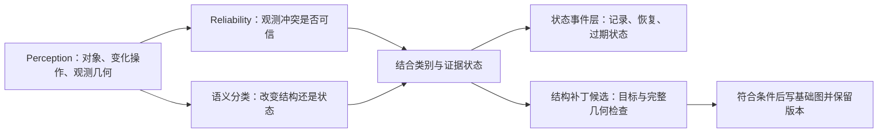

# 底图结构变更与地图状态事件（2026-11-08）

展示已升级为灰色底图 + 红色状态事件 + 黄色结构候选的可交互大地图；标注类别和来源见 [Perception 与大地图说明](perception_and_composite_map.md)。原始预测与本说明的数值结果保持不变。

用户修正了任务定义：需要区分“地图描述的结构改变”和“附着在地图上的状态”，不是预测持续时间长短。本次代码、写图条件、评价与网页均按此定义修改；原持续时间模型不再参与主流程。

[中文交互结果](https://yugongshit.github.io/AIE1903-map-update66/algorithms/zh/index.html) · [英文结果](https://yugongshit.github.io/AIE1903-map-update66/algorithms/en/index.html) · [完整 JSON](https://yugongshit.github.io/AIE1903-map-update66/algorithms/result.json)

## 1. 两种变化按什么区分

| 类型 | 改变的量 | 示例 | 保存位置 |
| --- | --- | --- | --- |
| 底图结构变更 | 道路/建筑要素的几何、属性、用途、连接关系，或对象新增删除 | 新增道路、车道边界移动、车道连接改变、建筑轮廓变化 | 基础地图的结构补丁与版本历史 |
| 地图状态事件 | 地图对象当前的占用、拥堵、封闭、风险或通行状态 | 车辆、路障、拥堵、施工封闭、塌方影响 | 独立事件层，关联道路对象/影响范围与时间 |

施工封闭持续几个月仍可属于状态；新车道刚出现也属于结构。**持续时间不能决定所属图层。** “施工”或“塌方”这个词本身也不充分：道路关闭是状态；若另有已核实的道路几何重建，则需要另一个结构变更记录。同一场景允许两者并存。



分类器与可靠性回答不同问题。“这个候选若成立应进哪层”可以回答，而“候选是否确实成立”仍可能证据不足。标线几何假设可以属于结构类，但不能因此宣称它已经被确认。实际占用成立也不意味着基础道路画错。

## 2. 区分算法：语义对象与变化操作的联合判定

实现：[map_layers.py](../map_update/map_layers.py)。输入使用 Perception 已提供的对象类别、`semantic_kind`、`change_type`，以及显式的结构/运行状态声明；不使用数据集名、持续时间、先前的长短期后验或评价真值。

1. 对对象和操作归一化。车辆/行人/障碍占用、拥堵和通行状态变化指向事件层；地图几何、标线属性、车道用途、拓扑、新增/删除结构对象指向底图。
2. 同时核对语义与操作。不能把“移除一辆车”误解为删除道路，也不能因为施工是暂时的，就把真实的车道几何改变全部排除在结构类之外。
3. 证据一致时输出所属图层及逐项依据。未知语义保留未决；同时有结构与状态声明时，要求拆成两个具体变化，不强迫二选一。
4. 再结合 Reliability：可信占用直接形成状态记录；可信结构冲突形成结构修改候选；未支持的差异只保存候选和原因。每项处理都有完成结果，不生成等待人工复核的任务。

这是**可解释的语义分类器**，不是训练出的机器学习模型；输出不伪装成百分比置信度。这里使用语义知识有实际理由：任务定义本身规定“改哪种地图量”，相同持续时间并不能区分两类。新的类别可以补充明确的对象/操作契约；有独立标注后，可用文本/视觉分类或梯度提升模型识别语义声明，保留当前图层与生命周期契约。没有训练集时，不能声称算法会自行学会新的变化类型。

## 3. Reliability 为什么这样设计

实现：[reliability_v2.py](../map_update/reliability_v2.py)。这是有明确假设的稳健几何估计器，参数为工程默认值，输出质量权重不是经过校准的正确概率。

1. **先统一物理边界身份。** 完全相同的 XY 曲线，包括反向存储，且标线属性相同，合并成一条物理边界并保留所有地图别名。Argoverse 438 条左右边界引用归并为 343 条物理边界，避免相邻车道共享边界造成假歧义。不同几何或不同属性不强行合并。
2. **重新计算局部匹配。** 在全部归并后的参考边界中，按距离与方向筛选；距离上限 3 m、方向差上限 25°，最优与次优距离差不足 0.25 m 时保留歧义。不能用真值选择最有利的别名。
3. **按观测本身评价局部质量。** 质量权重为 `sqrt(model_score × valid_projected_fraction) × min(curve_length / 3 m, 1)`；曲线至少 1.5 m，最低权重 0.35。显式对齐失败会拒绝。统一附在每条观测上的“可能混淆路沿”只是全局风险提醒，不再被当作每条曲线已经确认错误。
4. **比较同一位置。** 在参考曲线上预设间隔 5 m 的锚点及中点，选有最多不同帧覆盖的锚点；每帧计算观测曲线与同一条法线的交点残差，避免把不同路段的距离混成同一变化。锚点选择使用整个窗口，因此这一可靠性结果是离线窗口分析，不声称是更早时刻的在线结果。
5. **抵抗偶发坏帧与重复观测。** 同帧多相机先合并，再取 0.5 秒块内的残差中位数。对块残差计算中位数和 MAD（绝对偏差的中位数）。至少 3 块、跨度至少 1 秒、MAD 不超过 0.35 m、质量加权同方向偏差超过 0.5 m 的比例至少 70%，才支持局部几何冲突。MAD 很小不会让一个很小的绝对偏差自动显著。

这解决了部分身份、重复计数和硬拒绝问题。它不能自动消除持续的定位偏差、投影误差或路沿误检；这些错误可能连续多帧都很稳定。此次 Argoverse 的误报正说明“稳定”不能代替“正确”。有效可见性未知时，仍不能根据没看到某条线判断删除，也不能把局部观测当成完整替换几何。

nuScenes 使用独立适配器 [nuscenes_v2.py](../map_update/nuscenes_v2.py)：23 个占用候选有交付标注支撑的有效多边形、正的车道重叠和明确目标，支持“当前空间被占用”。其权重 1 来自标注输入契约，不是相机模型达到 100% 准确率。6 个标线候选没有确定修改目标，仍不能支持地图几何冲突；同一轨迹后续窗口的匹配不能倒填到前面的候选。

## 4. 状态标签如何生效和移除

实现：[state_events.py](../map_update/state_events.py)。状态层保存唯一事件 ID、关联地图对象、实际观测几何、最后观测时间和有效性，而不把观测物体焊进基础道路几何。

- 有支持的观测：记录该事件在观测时存在，更新最后观测与实际几何。
- 明确、完整地观察到恢复：移除同一事件的活动标签，保留已清除审计记录。
- 没有观测、遮挡或不完整恢复：不能当作已恢复；保留事件并表达当前有效性未知。
- 输入明确提供 TTL/到期时间时：到期只标过期/待重新观测的有效性，不宣称真实状态已经消失。当前交付没有有效期，程序不编造默认几分钟后恢复。

同一道路可以有多个事件。清除一个路障不能清除另一辆车；事件身份、时间截止和来源记录均分别核对。离线数据中的“观测时存在”也不代表现在仍存在。

## 5. 底图怎样改，什么条件仍不满足

写图资格由 [pipeline_v2.py](../map_update/pipeline_v2.py) 的 `write_gate` 单独检查：结构类别、受支持的冲突、当前截止时间内的有效支持、明确修改目标（或经验证的新增身份）、物理对齐、有效可见性和完整修改几何。**不再用三次复访或持续 24 小时作为结构类或写图的必要条件。** 连续帧与独立访问数仍可记录为诊断信息。

当前 Argoverse 只有局部观测曲线，无法保证它能完整替换某条边界；真实基础图因此没有改动。结构更新接口与已有 `engine.Maintainer` 的版本/回退能力保持区分：本次生成候选和资格结果，没有假装调用底图写入。新增道路需创建新对象及连接关系，修改已有车道需针对正确对象/边界应用几何或属性补丁，删除需有明确完整可见证据；不能只拿一条局部检测线覆盖整条道路。

原 `engine.Policy` 中三复访/24 小时仍保留给历史演示和测试，不是新版分类器的规则。原 `persistence.py` 的贝叶斯寿命模型也只保留为单独实验，不在新版主流程执行。

## 6. 两个数据集实际重跑结果

输入仍为交付的 Perception 结果，未重新运行相机神经网络。先写预测、参数和状态层并计算 SHA256，再读取 Argoverse M8 真值评价。

| 场景 | 类型判定 | 可靠性与实际保存 | 基础图结构写入 |
| --- | --- | --- | --- |
| nuScenes，29 个候选 | 23 状态、6 结构差异假设 | 23 个占用状态有标注几何与道路重叠支持并保存到状态层；6 个结构假设未证实 | 0 |
| Argoverse，76 个有观测窗口 | 71 结构假设；5 个局部一致窗口不适用变化分类 | 1 个局部冲突被采用为结构候选、70 个不足、5 个局部一致 | 0 |

这 23 个状态记录中，12 个在场景截止时仍有存在观测，11 个的最后证据早于截止时刻，因而末帧状态未观测；它们仍然明确属于状态事件，不是“无法区分结构还是状态”。没有实际恢复记录，所以没有擅自删除标签。

**不再使用原先的 23/29 长短期准确率。** 用户已经修正类别定义，旧的暂时/永久标签不能自动变成结构/状态真值。nuScenes 的 6 个结构候选不是“6 个长期分类错误”；它们是尚未得到支持的标线结构假设。当前可报告路由与记录是否按输入语义完成，但缺少独立结构/状态分类标签，不能给出独立分类准确率。

Argoverse 唯一被支持的局部几何冲突，中位偏移约 1.190 m、MAD 约 0.019 m、3 个时间块、跨度约 1.70 秒。对应物理边界别名为 `ls-168054223/left` 和 `ls-168076150/left`。**真值中这两条左边界几何没有改变，是 1 个物理几何误报。** 两个整车道对象的其他属性存在变化，不能因此把左边界预测奖励为正确，更不能把两个别名算成两次命中。

固定几何评价范围为历史图中已知有标线的 75 条物理边界；这批边界的几何变化真值正例为 0。新版 TP=0、FP=1、FN=0，精确率 0；召回率没有正例分母，不可计算。原 M4 确认结果为 0，不能称新版准确率提高。

全供给地图有 98 个变化对象；当前明确单一对象的粗检出仍为 0/98。该指标只检查对象是否发生任何变化，不验证边界侧和操作，因此不能代替上述精确几何评价；也不是可见区域检测准确率。

## 7. 究竟哪个模块有问题，以及下一步

**原可靠性与融合确有实现问题：** 共享物理边界制造匹配歧义；统一全局风险标签触发硬拒绝；未知可见性阻断所有判断。新版修正身份和全局风险的使用方式，并把正向局部冲突与删除所需的完整可见性分开。它仍会受到持续定位/投影误差和路沿混淆影响，此次误报就说明稳健统计不能消除系统性错误。

**原末端任务定义和接口也有问题：** 过去把图层性质与存续时间混为一谈，真实流程又没有执行寿命分类。如今已换成用户真正需要的结构/状态分类及状态生命周期，不能沿用原长短期指标证明新任务成功。

**Perception 与 Argoverse 的变化类型还不匹配：** 真值中 27 个车道对象的几何变化涉及 34 条左右边界引用，历史标线属性全为 `NONE`，其中 24 条在交叉口；当前 27 条仍为 `NONE`，4 条 `DASHED_WHITE`，3 条 `SOLID_WHITE`。引用可共享几何，不是 34 个独立物体。无漆线的虚拟车道边界、车道用途、拓扑或新增对象，需要相应的道路/可行驶区域/连接观测，不能期望可见标线检测独自完成。

具体下一步：

1. 扩展上游输出为标线、路沿/道路边缘、可行驶区域、拓扑与状态语义；对旧图 NONE 但出现可信新漆线建立“新标线/属性变化”假设，而不是直接宣称虚拟边界移动。
2. 用独立场景的匹配/非匹配、遮挡、路沿和投影误差样本训练与校准 Reliability；先比较逻辑回归/梯度提升等可解释方法，再考虑复杂时序模型。
3. 标注结构/状态及具体操作，并将混合事件拆成两项标签。按场景划分训练与测试，不随机拆同一段视频相邻帧。
4. 分别报告真实变化检测、图层分类、状态恢复、实际写图与误写率。分类路由正确不抵消几何误报；没有写基础图也不等于没有保存状态事件。

## 8. 复现

开发分支：`feat/structure-state-routing`。新输出目录必须不存在，原始交付不会被覆盖。

```bash
python3 scripts/run_change_pipeline.py --out outputs/pipeline-v3/my-run
python3 scripts/build_pipeline_studio.py \
  --result outputs/pipeline-v3/my-run/result.json \
  --out outputs/pipeline-v3/my-site
python3 -m unittest discover -s tests -v
python3 scripts/check_pipeline_studio.py outputs/pipeline-v3/my-site
```

`method.json` 保存方法；`*_predictions.json` 保存每个候选的类型、依据、可靠性和动作；`*_state_layer.geojson` 保存带城市坐标说明的事件图层，坐标不冒充经纬度；`prediction_freeze.json` 保存读取 M8 前的哈希；`result.json` 追加评价与旧新比较。网页提供完整运行结果下载。

验证包括语义/持续时间独立性、混合变化、事件恢复与过期、时间因果、同道路不同事件身份、几何可靠性和双语网页交互。合成正例验证路径可用，不代表真实准确率。

本版验证：200 项核心测试、232 项浏览器检查全部通过。详细记录见 [structure-state-validation-20261108.json](structure-state-validation-20261108.json)。网页验证范围为本地 HTTP 上的云端 Chromium/SwiftShader；不等于真实分类准确率或车辆验证。
