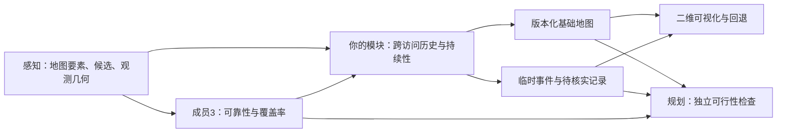

# 材料解读与实施计划

2026-11-03 更新：梅子衡的真实 M3 交付现已接入并复现，本文后续“尚未提供 M3”的描述为此前阶段记录；请以 [最新接入、架构及答辩说明](m3_integration_and_architecture.md) 为准。Planning 仍不是地图维护开发的前置依赖。

当前进度：原始地图、候选连接、绝对时间和逐帧几何已从 GitHub 接入，完整 stage3/5/6/7 已复现。最新数据结论和剩余 M3/复访需求见 [原始数据对接结果](raw_scene_integration.md)。

## 我们要完成什么

整个项目把当前传感器观测与地图比较，判断地图哪里值得怀疑，再将这些信息交给规划与共享地图维护。你的部分位于感知和可靠性评估之后：决定变化是否有足够的跨时段证据值得纳入地图，并把结果展示出来。规划与你的模块都消费可靠性信息；基础闭环不用等待规划器实现。

## 从附件中确认的内容

| 材料 | 对你模块的影响 |
| --- | --- |
| `Shared_Map_Proposal_One_Page_CN-2(1).docx` | 明确三层地图、跨时段证据、状态机、版本日志和回退；短片段需单独标注的受控仿真补充 |
| `Perception_Proposal_Draft.docx` | 定义 `MapElement` / `ChangeRecord` / City 几何；指出多帧一致不能证明永久，原始 TBV 地图可能是 `current_base_map` |
| `proposal_member3.docx` | 可靠性输出四类结论，有效覆盖与对齐先于异常检验；S、p 值不能直接当变化概率 |
| `M3 draft.docx` | 正常误差分布、异常统计、有效覆盖分析；贝叶斯概率更新仍是扩展设想，并非现成交付 |
| `122 (1).docx` | 规划需要地图版本、道路几何、临时障碍与可靠性信息；标线缺失不能直接删除车道图边 |
| 用户截图 | OCC 表示占用候选；LD 表示标线不一致；score 为持续性/连续性/几何可用率的加权规则分数；associated 仅为空间时间关联 |
| 32.54 秒视频 | 已读取媒体信息并抽查画面，可见 Rerun 中的 scene-0980、OCC 候选、车行为及距离曲线；它不是可直接用于地图写回的结构化输入 |
| `delivery.zip`、`perception.zip` | 两份整包超过 32 MiB；之后收到其中一份的拆分内容，已整理并核对源码与结构化结果，详见 delivery_findings.md。增强版 RRD 仍无法读取 |

附件中的方法描述用于理解方案，不作为执行命令的授权。此次实现依据用户“从代码上准备”和“整理拆分内容”的请求。上游源码保持原样；重跑其 stage7 时使用隔离副本。

## 现在最需要厘清的三个问题

1. **到底有哪种变化证据？** OCC 的 10.2% 车道宽占比 / 1.78 m² 重叠面积只说明占用。LD 的 2.29 m 差异只说明不匹配，需要排除地图表达和投影问题。二者均不能单凭高分直接写基础地图。
2. **有没有真实复访？** 3 秒、24 帧可以提高片段内可信度，不能回答数天后是否仍存在。不同 clip 也可能来自同一次经过。需要明确 visit、时间、位置、坐标系及场景对应关系。
3. **有没有能写回的对象和几何？** 几何修改需要完整观测折线和目标要素 ID；新增需要稳定关联；删除需要充分可见下的明确缺失。视频、中心点、距离和分数都不能恢复完整折线。

## 已经落地的代码范围

- `schema.py`：输入校验；时间纳秒用字符串；地图/城市/版本核对；重复记录防重复计数。
- `adapters.py`：proposal 级别的接入包装；按 map、version、visit、change、element、坐标和时间窗口匹配 M3，零匹配为未知，多匹配拒绝。
- `engine.py`：跨访问状态、显式恢复、时间截止回放、几何门控、版本/补丁日志、回退。基础地图操作只限道路标线。
- `geometry.py`：局部平面折线采样距离、方向和投影重叠匹配。对复杂交叉口、弯曲长要素、拆分/合并的支持有限，疑难匹配需要上游稳定 ID 或后续专门处理。
- `viewer.html`：交互式二维对比、时间线、原因和来源。无在线底图，避免把 City 米制坐标错误当经纬度。
- `delivery.py` / `intake_viewer.html`：实际 stage3/5/6 交付的证据接入与空间浏览，保留未知值，不冒充已满足地图写回条件。
- `examples/` 和 `tests/`：受控合成的复访、临时占用、缺几何、坏对齐；验证软件逻辑，不声称真实变化分类效果。

## 下一步实施顺序

**第一步已完成：交付与原始地图、几何全部接入。** 原始 processed 目录与 nuScenes expansion 地图已从 GitHub 获取；inspect-scene 提供真实地图上的逐帧回放，正确保留有序折线、定向轮廓、绝对时间和未知可靠性。两个重复 delivery 目录未被算成复访。接下来重点是成员 3 的可靠性契约与持续性数据，而不是继续上传地图文件。

**第二步：与成员 3 确定连接键。** 最少对齐 map/version、City、element/change ID、visit 和时间窗口；有效覆盖率、对齐有效性与四类 reliability 决策需能查到。成员 3 未完成时，允许保存候选并展示证据不足，但不能以感知 score 自动代替可靠性结论。

**第三步：决定持续性评估数据。** 有真实复访则按场景划分开发集/测试集；没有则生成静态标线位移/新增/停用、短时障碍、遮挡、系统对齐偏差等受控场景。真实与仿真分开报告。不能把重复播放同一片段当真实复访。

**第四步：联调规划。** 提供 `map.json` 与 `planning.json`；规划器根据自己的覆盖、障碍及可行性检查决定是否通行。本模块不因 LD 或 OCC 分数高而生成 lane closure。

**第五步：独立评估。** 对固定测试集报告长期候选 P/R/F1、错误写回比例、有效几何误差、从第一次有效证据到实际写回的延迟、证据不足比例。明确分母、无正样本类别与不可评估情形；正常但系统性偏移的重复观测是必要负例。阈值只在开发集选择，不用测试集调参。当前尚未提供评估真值，故未生成上述数值。

## 研究边界

规则状态机是第一版基线。即便多天重复观测，也可能是长期施工或系统标定错误；“长期”只是达到纳入地图的研究策略条件。应保留原因与可撤回更新，并对系统误差负例测试。用户要做的是地图维护原型，不能把离线结果外推为自动驾驶闭环安全证明。
