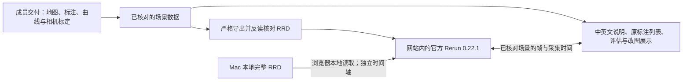

# Rerun 接入与运行检查（2026-11-05）

英文入口：https://yugongshit.github.io/AIE1903-map-update66/en/index.html#rerun

中文入口：https://yugongshit.github.io/AIE1903-map-update66/zh/index.html#rerun

## 给组内说明的实现方式

现有网站负责解释证据、查看地图修改和评估；内嵌的官方 Rerun 查看器负责原生的平移、缩放、三维观察、属性检查和时间轴。默认录制读取成员交付的真实地图、逐帧感知曲线、nuScenes 原标注及相机标定投影，重新封装为 RRD。它不是新的模型输出，也不包含目前无法读取的相机照片。



核心改图引擎不依赖 Rerun。真实 scene-0980 的 29 个变化候选中，没有足够证据确认长期基础地图变化，真实写入保持 0。受控副本演示引擎写入、版本记录和回退；它不能替代真实复访数据。Argoverse 未运行，规划与跨车共享仍是未接入能力。

## 操作

1. 点击网站的 **Rerun** 页签，等待首次约 28 MB 查看器及约 5 MB 场景录制加载。
2. 在原生窗口拖动、滚轮缩放、选择物体；点“显示物体属性”展开 Rerun 属性面板。原始类别及中文翻译的完整可点击列表仍在“类别标注与原视频”中。
3. 默认用 `elapsed_s` 按真实采集间隔播放；网页帧滑块与已核对场景双向同步。点候选和“打开此帧的证据”可进入对应复核页面。
4. “原始增量叠加”读取用户提供过的原始 overlay RRD，文件未经改写。它缺少基础录制和图像，时间轴独立。
5. “打开本地 RRD”直接读取电脑文件，不上传。文件版本必须为 0.22.1；未知场景/时间不能假装已与当前评估对齐，因此关闭网页联动。刷新或切换语言后需要重新选本地文件。
6. 大文件可能超过浏览器内存；可点“卸载 / 取消”结束读取，或使用对应版本的原生 Rerun。查看器启动失败时，原网页、视频和评估仍可操作。
7. “问题清单”上方有中英文分别生成的 **Word 检查报告** 下载。

Rerun 原生控件为英文，内置字体可能无法显示所有中文。中文网页的类别列表提供完整翻译，英文保留原 category 字符串。地图仅为显示而裁切；不修改源坐标。默认相机投影使用标定与 z=0 地图近似，不是实景照片；实际轨迹不是推荐路线。

## 修复及验证

详见 [机器可读审查记录](runtime-audit-20261105.json)。已有代码的两项问题为无效多边形通过检查、wheel 漏装翻译表；本次接入时另外发现并修复了旧 SDK 的属性丢失/类别截短，以及静态网站无后缀模块路径 404。

- 核心回归：92 项通过，其中新增 8 项多边形输入案例；另外对本场景 157 个实际地图元素校验通过。当前校验不覆盖孔洞之间的全部拓扑关系。
- 安装包：独立打包、隔离导入通过，728 条翻译随 wheel 安装。
- RRD：中英文分别从保存文件反读，全部 2,278 条原标注的类别、实例/标注 token、位置、尺寸、旋转与来源一致。对象显示框为原标注几何；它们不是重新估计出的三维模型。
- 双语网站原有 40 项交互检查通过；新增 33 项真实 WebGL / 文件读取 / 时间联动检查通过。
- 浏览器检查覆盖云端 Chromium + SwiftShader，不能替代真实 Mac、Safari 和实车验证。首次下载、浏览器显存和大文件内存仍需在实际演示机上确认。

## 可复现构建

使用独立 Python 3.10–3.12 虚拟环境安装 `requirements-rerun.txt`；不要把 Rerun 的依赖版本强行覆盖到成员模型环境。

```bash
python -m venv /tmp/aie-rerun-venv
/tmp/aie-rerun-venv/bin/pip install -r requirements-rerun.txt
python scripts/fetch_rerun_viewer.py /tmp/aie-rerun-viewer
/tmp/aie-rerun-venv/bin/python scripts/export_rerun_scene.py \
  --source outputs/nuscenes/scene-0980/bilingual-release-20261104/en/index.html \
  --raw 'AIE1903 原始资料' \
  --out outputs/nuscenes/scene-0980/rerun-recordings-new
python scripts/build_rerun_site.py \
  --source outputs/nuscenes/scene-0980/bilingual-release-20261104 \
  --recordings outputs/nuscenes/scene-0980/rerun-recordings-new \
  --vendor /tmp/aie-rerun-viewer \
  --overlay external/perception_delivery/outputs/visualization/scene-0980_results_overlay.rrd \
  --out outputs/nuscenes/scene-0980/rerun-site-new
python -m unittest discover -s tests -q
python scripts/check_bilingual_studio.py outputs/nuscenes/scene-0980/rerun-site-new
python scripts/check_rerun_site.py outputs/nuscenes/scene-0980/rerun-site-new
```

网站构建需要 `python-docx`；浏览器检查需要 Playwright、Pillow 与 `/usr/bin/chromium`。输入为先前已经检查通过的双语场景构建，需要保留可读的成员交付数据及此前构建产物。输出目录必须不存在。脚本保存 npm 校验值、许可证、输出 SHA256、反读核对结果和浏览器检查结果。SDK 原包只为静态托管补 `.js` 导入后缀；页面同站提供 WASM，不依赖第三方 CDN。
