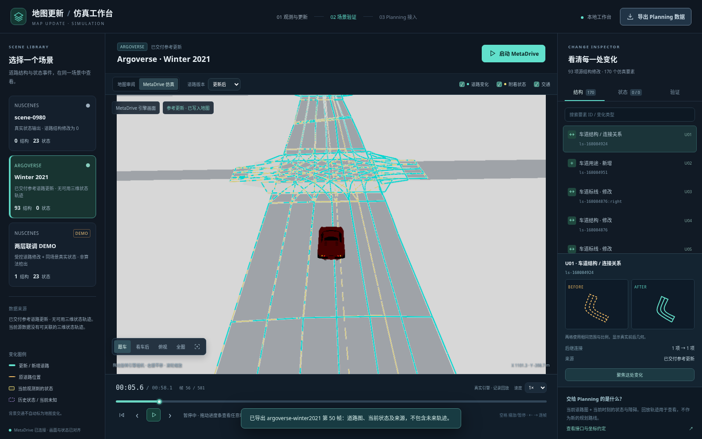
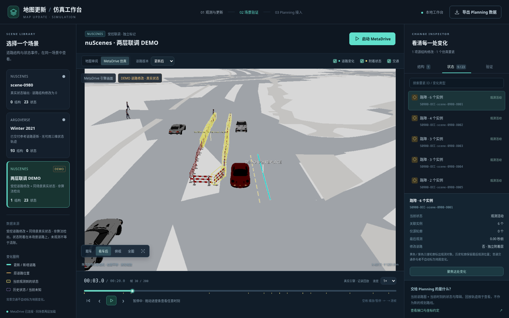

# 场景与地图更新平台

平台将场景选择、道路前后对照、附着状态、回放、验证和 Planning 导出放在一个界面中。每个场景保留自己的数据集、城市坐标和来源；道路结构与状态始终使用同一个场景、同一个回放时刻。

## 启动

已经安装过 `aie1903-sim` 环境时，在 Mac 终端执行：

```bash
cd ~/Desktop/AIE1903-map-update66
git pull --ff-only
conda activate aie1903-sim
python scripts/run_simulation_platform.py
```

浏览器自动打开 **http://127.0.0.1:8091/**。终端保持运行，按 `Ctrl+C` 关闭服务和仿真工作进程。已有仿真依赖与仓库内 Three.js 即可使用，无需重新创建环境或运行 npm 安装。

端口占用时可运行 `python scripts/run_simulation_platform.py --port 8092`。不希望自动打开浏览器时加 `--no-browser`，再手动访问终端打印的地址。首次安装见[仿真依赖说明](simulation_bridge.md#安装)。

这是本地 Python 服务，真实 MetaDrive 由本机环境运行。GitHub Pages 上的静态网页不会自动启动本机引擎。

## 更新后重启与画面错误

更新本平台代码后，先在原运行终端按 `Ctrl+C` 停止服务，再执行上面的 `git pull --ff-only` 与启动命令；浏览器刷新页面（Mac 可用 `Command+Shift+R`），然后重新选择场景并启动 MetaDrive。只刷新网页不会更新仍在运行的 Python 服务，无需重装依赖。

真实引擎的新画面成功下载、解码并匹配状态快照后，画面与时间轴才一起更新。图片读取失败会自动重试；持续失败时暂停回放、保留上一张有效画面及其时间，Planning 导出也保持该时刻。视图中会常驻显示错误原因，可点击 **重试这帧画面** 或 **重新生成当前帧**；图像过期或引擎已被别的页面切换时，可重新启动所选场景。

macOS 若出现 `Invalid simulation frame path`，原因是 `/var/...` 与 `/private/var/...` 指向同一临时目录，却被旧检查当成不同目录。现在临时根目录与图片路径都先解析为真实路径，再检查归属。回归测试通过真实目录符号链接复现原报错，并确认合法图片可以加载、目录外文件仍被拒绝。更新后同样需要重启 Python 服务。

先前版本在连续播放时会拒绝稍晚到达的旧帧请求，也可能在引擎重启后误删新生成的第一张图。本次修复为每张已生成图片分配独立标识，并缓存其实际字节；测试专门覆盖连续播放、图片延迟、失败恢复及重启，不再只检查单张截图。

本次图片传输修复在 Linux 真实 MetaDrive 上另行通过 34 项相关 Python 测试、27 项专项浏览器检查，以及原有 21 项平台操作回归。专项检查人为延迟 PNG 900 毫秒、注入短暂/持续 HTTP 错误并测试恢复；749 次展示采样中，已显示图像、时间轴和状态保持一致，没有在图片尚未返回时继续推进。真实工作进程关闭后重新启动，也确认序号 1 的新图可读取，旧进程的画面标识被拒绝。

专项检查可复现（先运行平台，测试环境另需 Playwright/Chromium）：

```bash
python scripts/check_simulation_frame_delivery.py --url http://127.0.0.1:8091 --out outputs/frame-delivery-check-new
```



## 播放与相机性能

2026-11-11 优化了真实引擎到网页的整条显示链路：跳帧时暂停全部图形缓冲区，完整执行中间物理步进后再绘制目标画面；同一时刻转动相机复用状态与标注；常规画面只绘制一次，首次加载或重置保留预热。PNG 使用较低压缩级别，仍为无损 1000×650 图片。网页直接等待任务完成通知，并随结果接收同帧状态，减少轮询等待、额外请求及隐藏审阅视图的重复更新。连续拖动相机每 40 毫秒合并发送最新位置，操作队列始终有界。

1× 播放在渲染足够快时逐帧显示；较慢机器每张画面最多推进两个源时间步，所有物理步仍执行。时间轴显示实际源时刻，手动逐帧和进度定位仍精确到指定帧。显示速度受本机图形性能限制，1× 是目标速度。

同一 Linux 云端软件渲染环境、同一 nuScenes scene-0980 更新地图的一轮端到端对比：

| 指标 | 优化前 `13799ef` | 优化后 |
| --- | ---: | ---: |
| 浏览器实际显示帧率 | 0.52 FPS | 1.58 FPS |
| 每秒墙钟时间推进的源场景时间 | 0.104 秒 | 0.302 秒 |
| 转视角到画面显示，中位数 | 1.114 秒 | 0.595 秒 |
| 向后定位，第 20 → 5 帧 | 6.024 秒 | 4.016 秒 |
| 向前定位，第 5 → 20 帧 | 6.828 秒 | 0.580 秒 |

两版均使用相同分辨率与图层。播放测量从第 0 帧开始，旧版显示 10 张画面到第 20 帧，新版显示 11 张到第 21 帧；表中分别按真实画面数和源时间归一化，未用源帧数冒充显示 FPS。转视角及定位测试在相同帧开始。新旧版分别有 1428 / 2257 次展示采样，画面、快照、地图哈希与时间轴均一致。测量范围为开头约两秒源数据，不能代表每个时刻或用户 Mac 的性能；云端软件渲染仍未达到实时播放。启动耗时因进程与缓存冷热不同未作比较。

可审计数值、前端与引擎文件哈希见 [性能测量记录](../demo/simulation/validation/browser-performance.json)。复测时关闭其他仿真任务，用同一机器、场景和参数分别运行两版服务：

```bash
python scripts/benchmark_simulation_platform.py --url http://127.0.0.1:8091 --label local --start 0 --end 20 --out outputs/performance-local-new
```

该开发检查另需 Playwright/Chromium；日常启动平台无需安装测试工具。此轮通过 42 项相关 Python 测试、21 项平台浏览器回归、27 项图片传输回归，以及上述 6 项性能测量一致性检查。图片传输回归包含 900 毫秒延迟、失败重试、跨模式切换及当前帧 Planning 导出。更新后按上文重启 Python 服务并强制刷新浏览器。

## 选择场景与两层变化

左侧场景卡片直接显示 nuScenes 或 Argoverse。当前提供：

| 场景 | 道路结构层 | 附着状态层 | 来源 |
| --- | --- | --- | --- |
| nuScenes · scene-0980 | 当前可执行结构修改 0 项 | 23 个事件，全程关联 74 个实例 | 算法状态输出 |
| Argoverse · Winter 2021 | 93 项源参考更新，落实为 170 项仿真要素修改 | 当前材料没有可用三维状态轨迹 | 已交付参考更新 |
| nuScenes · 两层联调 DEMO | 一条标线沿城市 X 移动 1 米 | 同一 scene-0980 的真实状态事件 | 受控道路修改，明确标记 DEMO |

每个场景都有结构和状态两层接口；没有对应数据时显示零项及原因。Argoverse 的道路修改不会移到 nuScenes 上。联调 DEMO 用来检验两层同时显示和版本切换，不进入算法准确率统计。

结构修改写入实际道路图，包括车道几何、标线、连接关系及通行属性。状态保留对象身份、观测时间、轮廓及活动/未知等状态，不变成永久车道或路面。普通背景行人、车辆和自行车保持原轨迹；只有关联了状态事件的对象才标为变化。

nuScenes 的 74 个关联实例包括 45 个路障、26 个锥桶及 3 个杂物。71 个实例可关联原仿真模型，3 个杂物只有源轮廓。另有 103 个物理路障/锥桶使用“首次出现后持续保留”的仿真策略，两个统计范围不同。未知状态、隐藏标注和切换道路版本都不代表障碍已清除。

## 地图审阅与真实 MetaDrive

**地图审阅**使用本地 Three.js 显示源地图、参与者和状态轮廓，适合快速旋转、拖动时间、并排比较道路版本。参与者采用有源尺寸的简化几何；缺少实测高度、模型或周边建筑时，不生成虚构建筑与山地。

点击 **启动 MetaDrive**，工作台会在独立进程中载入选中场景，将 Panda3D 实际渲染的画面显示到 **MetaDrive 仿真** 模式。网页三维审阅与真实引擎画面有各自的模式标识。

MetaDrive 启动、版本切换和大跨度跳帧需要等待加载。仿真操作串行执行；当前操作完成前，界面显示忙碌状态。向前定位会步进到目标帧；向后定位会重置并重放到目标帧，避免未来出现的障碍留在更早时间中。画面从暂停位置继续，不会因进入平台而改成键盘驾驶。

当前开发验证环境为 Linux 离屏渲染；macOS 分支使用 Panda3D 的本机图形后端，实际运行情况仍以本机结果为准。启动失败时先确认终端使用已安装 MetaDrive 的 `aie1903-sim` 环境，并查看界面错误信息。

## 看清改了哪里

视图上方选择 **原始道路**、**更新后**；地图审阅还可选择 **前后并排**，两侧使用相同相机与时刻。状态层保留在同一个场景里，切换道路版本不会把同一时刻的障碍丢掉。MetaDrive 的版本切换会重载对应数据库并恢复到所选帧。

| 标注 | 含义 |
| --- | --- |
| 青色道路几何 | 更新后或新增部分 |
| 橙色虚线 | 修改前道路位置 |
| 红色虚线 | 已删除的道路几何 |
| 黄色状态轮廓 | 当前源观测支持的状态 |
| 紫色状态轮廓 | 保留的历史位置，当前未知或陈旧 |

右侧 **结构** 和 **状态** 列表可以搜索要素 ID 或变化类型。选择一项可查看来源、变化前后属性和时间信息，并用聚焦按钮定位它。对象轮廓、标签与选中标记帮助找到路障、杂物等变化，不需要只凭路面颜色辨认。

道路用途或连接关系变化可能没有明显几何位移，需要查看属性前后值。例如普通车道改为公交车道，几何可以不变，但 `source_lane_type` 与 `vehicle_access` 会改变规划可通行性。高亮颜色是查看辅助，不改变源标线材质。

“道路变化”和“附着状态”控制标注显示。“交通”开关只用于网页地图审阅中的参与者显示；它不删除 MetaDrive 物理世界中的交通对象。

## 视角与时间轴

- 左键拖动旋转视角，右键拖动平移，滚轮缩放。
- 使用 **跟车**、**看车后**、**俯视**、**全图** 或聚焦选中变化调整视角。
- 时间轴支持前进和后退定位；播放/暂停、回到第一帧和逐帧按钮位于下方。空格播放/暂停，左右方向键逐帧。
- 可选择 0.5×、1×、2×、4× 播放速度。MetaDrive 实际速度受本机渲染与加载速度影响。

回放时间是记录中的时间，不是新规划轨迹。nuScenes 状态使用原始关键帧的精确源时间；插值帧保持最近已到达观测，并报告观测年龄。状态过期按明确到期时间推进，未来对象不会提前显示。

## 怎样理解“正确率”

右侧 **验证** 页区分两种问题：

| 检查 | 能回答的问题 |
| --- | --- |
| 地图写入与完整性 | 场景、补丁和状态来源是否匹配；修改能否重建更新图；道路几何、拓扑和权限是否保持约定 |
| 算法检测评估 | 对有独立真值的对象，算法检出了多少、误报多少，以及局部几何偏移是否准确 |

已有源地图的裁剪外连接、转换缺失或几何问题会作为源数据限制报告；不能把“没有引入新的错误”写成“整幅地图正确率 100%”。

当前冻结输出中，Argoverse 局部边界评估涵盖 343 条源物理边界，其中 340 条可评估、3 条真值范围不明确而排除：

| 指标 | 结果 |
| --- | --- |
| 检出精确率 Precision | 9 / 14，约 64.3% |
| 召回率 Recall | 9 / 31，约 29.0% |
| F1 | 0.40 |
| 局部偏移误差在 0.5 米内 | 3 / 14 个检出 |

这些指标描述局部边界身份检出与偏移，不能直接代表完整地图补丁准确率。当前算法最终执行的结构修改仍为 0。显示的 93 项参考更新来自已交付真值资料，与模型预测分别保存。

nuScenes 缺少足够的独立变化真值，当前不提供其结构/状态变化的检测准确率。实例 ID 匹配成功、对象持续显示或测试通过，都不能替代独立真值评价。评估数据与来源哈希保存在 `demo/simulation/validation/detection_metrics.json`。

## 给 Planning 同学的输入

右上角 **导出 Planning 数据** 下载当前选定场景、道路版本、时间点的 JSON，格式为 `simulation-planning-handoff-1.0`。导出保留源城市 XY 米制坐标；不要再减去网页用于显示的原点。

| 字段 | 用途 |
| --- | --- |
| `identity`、`coordinate_reference` | 数据集、场景、地图、坐标系与单位 |
| `map_version` | 当前道路要素的 SHA-256，用于版本核对 |
| `map_features` | 当前道路几何和属性 |
| `lane_graph` | 车道出入连接、源车道用途、通行权限 |
| `step`、`time_s`、`source_timestamp_ns` | 回放帧与精确源时间；纳秒时间保留十进制字符串 |
| `map_state_snapshot` | 当前可用状态事件、对象轮廓、最后观测时间与生命周期 |
| `current_objects`、`current_ego` | 当前帧参与者与自车状态 |
| `persistent_obstacles` | 当前已经出现并按仿真策略保留的障碍 |
| `provenance` | 数据范围、场景/状态来源与哈希 |

`route` 和 `requested_goal` 为 `null`，由 Planning 自行指定。导出不含完整未来交通轨迹或原自车回放路线；未知通行属性保持未知，不自行解释成开放道路。

也可以通过本机 HTTP 接口读取：

```python
import json
from urllib.request import urlopen

url = (
    "http://127.0.0.1:8091/api/scenes/nuscenes-scene0980/planning"
    "?step=137&version=updated"
)
with urlopen(url) as response:
    data = json.load(response)

road_map = data["map_features"]
lane_graph = data["lane_graph"]
states = data["map_state_snapshot"]
objects_now = data["current_objects"]
ego_now = data["current_ego"]
```

场景键还包括 `argoverse-winter2021` 和 `nuscenes-combined-demo`；`version` 可选 `original` 或 `updated`。这个接口输出选中回放帧的数据，不运行规划器。接入新目标与控制器，在真实仿真中检验新路线，使用[独立规划控制接口](simulation_bridge.md#自己指定目标并接规划器)。回放和自由查看本身不能证明新规划路线安全或可达。

## 已完成的验证

四份实际数据库（Argoverse 原图、更新图，nuScenes 状态场景和两层联调场景）的写入检查均通过；原始数据中已有的几何覆盖和裁剪外连接问题保留为警告。

本次 Linux 验证运行了 488 项 Python 测试，487 项通过、1 项按条件跳过；另有 21 项浏览器验收通过。浏览器验收实际启动 MetaDrive，检查后视相机、障碍聚焦、30 → 5 → 30 帧重建、原图/更新图切换、地图哈希和当前 Planning 导出。测试结果证明这些实现行为符合约定，不替代上面的独立算法准确率评价。

开发环境可复现：

```bash
python -m unittest discover -s tests
# 先启动平台；以下检查器另需开发环境中的 Playwright 与 /usr/bin/chromium。
python scripts/check_simulation_platform.py --url http://127.0.0.1:8091 --out outputs/platform-check-new --engine
```

下图为两层联调 DEMO 的真实 MetaDrive 画面：道路修改使用受控样例，同场景路障来自真实状态数据，黄色立体框标出关联路障。


